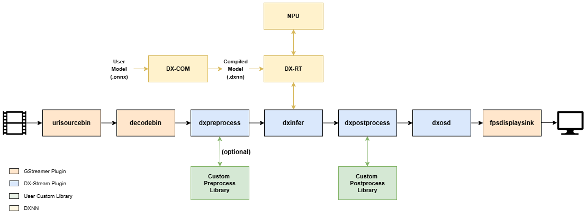

<div align="center">

# DX-STREAM

**GStreamer elements for building Vision AI pipelines on DEEPX NPUs.**

[](https://github.com/DEEPX-AI/dx_stream/releases)
[](https://developer.deepx.ai/tech-docs/DXNN-SDK/DX-STREAM/DXNN_Streamer_Overview/)

</div>

<div align="center">
  <picture>
    <source media="(prefers-color-scheme: dark)" srcset="./img/01_02_DX-STREAM_Architecture_Overview-dark.png">
    
  </picture>
</div>

DX-STREAM is the GStreamer plugin of the DXNN® SDK. It runs `.dxnn` models from
[DX-ModelZoo](https://developer.deepx.ai/modelzoo/) or [DX-COM](https://github.com/DEEPX-AI/dx-compiler) on a
DEEPX NPU through [DX-RT](https://github.com/DEEPX-AI/dx_rt), inside a standard `gst-launch-1.0` pipeline. Most
models need only element properties and JSON config files; custom libraries cover the rest. It is part of
[DX-Runtime](https://github.com/DEEPX-AI/dx-runtime), the target-side bundle of
[DX-AllSuite](https://github.com/DEEPX-AI/dx-all-suite), which keeps the SDK component versions aligned.

- **Pre-process → infer → post-process as elements** — `dxpreprocess`, `dxinfer` and `dxpostprocess`, plus tracking (`dxtracker`), overlay (`dxosd`), rate control, scaling and color conversion.
- **Multi-stream** — `dxinputselector` and `dxoutputselector` run many streams, even with different resolutions, through one inference chain.
- **Secondary inference** — cascade models on detected objects in the same pipeline.
- **Messaging** — `dxmsgconv` and `dxmsgbroker` send results to MQTT or Kafka.
- **Custom libraries** — plug your own pre-processing, post-processing and message conversion into the pipeline.

## What You Need

| | |
|---|---|
| **Arch** | x86_64, aarch64 |
| **OS** | Ubuntu 20.04 / 22.04 / 24.04 / 26.04 LTS, Debian 12 / 13, Windows 10 22H2 or later (x64) |
| **Memory** | 8 GB RAM (16 GB recommended), 4 GB free disk |
| **NPU** | DX-M1, DX-M1M or DX-H1 Quattro |
| **DX-RT** | v3.5.0 or later, with NPU driver v2.7.0+ |
| **Libraries** | GStreamer 1.16.3+, OpenCV 4.2.0+ (`install.sh` installs both) |

## Quick Start

Install the NPU driver and DX-RT first (see [DX-RT](https://github.com/DEEPX-AI/dx_rt)). Then build DX-STREAM
and run the interactive demo:

```bash
git clone https://github.com/DEEPX-AI/dx_stream.git
cd dx_stream
./install.sh                   # GStreamer, OpenCV and other dependencies
./build.sh                     # build and install the plugin to /usr/local
source ~/.bashrc
gst-inspect-1.0 dxstream       # lists dxpreprocess, dxinfer, dxpostprocess, ...
./setup.sh                     # sample models and videos
./run_demo.sh                  # pick a demo from the menu
```

`run_demo.sh` offers demos for object detection (YOLO26n, YOLOv5s with PPU), face detection, pose, instance
segmentation, depth, multi-object tracking, multi-channel detection (file and RTSP) and a multi-model cascade.
With no input, it runs the first demo after a short timeout.

If `gst-inspect-1.0 dxstream` reports "No such element or plugin", clear the cache with
`rm -rf ~/.cache/gstreamer-1.0/` and try again.

## Write a Pipeline

From the `dx_stream` folder, after `./setup.sh`, this runs YOLOv5s with PPU on a sample video:

```bash
gst-launch-1.0 urisourcebin uri=file://$PWD/dx_stream/samples/videos/boat.mp4 ! decodebin ! queue ! \
    dxpreprocess config-file-path=dx_stream/configs/YoloV5S_PPU/preprocess_config.json ! queue ! \
    dxinfer config-file-path=dx_stream/configs/YoloV5S_PPU/inference_config.json ! queue ! \
    dxpostprocess config-file-path=dx_stream/configs/YoloV5S_PPU/postprocess_config.json ! queue ! \
    dxosd ! videoconvert ! fpsdisplaysink sync=false
```

Each demo is a script under `dx_stream/pipelines/` that you can copy and change:

| Pipeline | Script | Guide |
|---|---|---|
| Single stream | `single_network/object_detection/run_YoloV5S_PPU.sh` | [Single Stream](https://developer.deepx.ai/tech-docs/DXNN-SDK/DX-STREAM/05_01_Single-Stream/) |
| Tracking | `tracking/run_multi_object_tracker.sh` | [Single Stream](https://developer.deepx.ai/tech-docs/DXNN-SDK/DX-STREAM/05_01_Single-Stream/) |
| Multi stream | `multi_stream/run_multi_stream_selector.sh` | [Multi Stream](https://developer.deepx.ai/tech-docs/DXNN-SDK/DX-STREAM/05_02_Multi-Stream/) |
| Secondary inference | `secondary_mode/run_secondary_mode.sh` | [Secondary Inference](https://developer.deepx.ai/tech-docs/DXNN-SDK/DX-STREAM/05_03_Secondary-Inference/) |
| Message broker | `broker/run_dxmsgbroker_mqtt.sh`, `run_dxmsgbroker_kafka.sh` | [MsgBroker](https://developer.deepx.ai/tech-docs/DXNN-SDK/DX-STREAM/05_04_MsgBroker/) |

To use your own model or post-processing → [Writing Your Own Application](https://developer.deepx.ai/tech-docs/DXNN-SDK/DX-STREAM/Writing_Your_Own_Application/)

<details>
<summary><b>Elements</b></summary>

| Element | Role |
|---|---|
| [DxPreprocess](https://developer.deepx.ai/tech-docs/DXNN-SDK/DX-STREAM/03_01_DxPreprocess/) | Pre-processes frames for inference |
| [DxInfer](https://developer.deepx.ai/tech-docs/DXNN-SDK/DX-STREAM/03_02_DxInfer/) | Runs the model on the NPU |
| [DxPostprocess](https://developer.deepx.ai/tech-docs/DXNN-SDK/DX-STREAM/03_03_DxPostprocess/) | Decodes the model output |
| [DxTracker](https://developer.deepx.ai/tech-docs/DXNN-SDK/DX-STREAM/03_04_DxTracker/) | Tracks objects across frames |
| [DxOsd](https://developer.deepx.ai/tech-docs/DXNN-SDK/DX-STREAM/03_05_DxOsd/) | Draws results on frames |
| [DxGather](https://developer.deepx.ai/tech-docs/DXNN-SDK/DX-STREAM/03_06_DxGather/) | Merges branches of one stream |
| [DxInputSelector](https://developer.deepx.ai/tech-docs/DXNN-SDK/DX-STREAM/03_07_DxInputSelector/) | Merges input streams by PTS |
| [DxOutputSelector](https://developer.deepx.ai/tech-docs/DXNN-SDK/DX-STREAM/03_08_DxOutputSelector/) | Splits results back per stream |
| [DxRate](https://developer.deepx.ai/tech-docs/DXNN-SDK/DX-STREAM/03_09_DxRate/) | Controls the frame rate |
| [DxMsgConv](https://developer.deepx.ai/tech-docs/DXNN-SDK/DX-STREAM/03_10_DxMsgConv/) | Converts results to messages |
| [DxMsgBroker](https://developer.deepx.ai/tech-docs/DXNN-SDK/DX-STREAM/03_11_DxMsgBroker/) | Sends messages to a broker |
| [DxScale](https://developer.deepx.ai/tech-docs/DXNN-SDK/DX-STREAM/03_12_DxScale/) | Scales frames |
| [DxConvert](https://developer.deepx.ai/tech-docs/DXNN-SDK/DX-STREAM/03_13_DxConvert/) | Converts color formats |
| [DxVnpuDec](https://developer.deepx.ai/tech-docs/DXNN-SDK/DX-STREAM/03_14_DxVnpuDec/) | Decode video on the DX-H1 V-NPU |
| [DxVnpuEnc](https://developer.deepx.ai/tech-docs/DXNN-SDK/DX-STREAM/03_15_DxVnpuEnc/) | Encode video on the DX-H1 V-NPU |

Multi-stream pipelines use the `application/x-dxvideoraw` caps between the selectors →
[Multi-Stream Domain](https://developer.deepx.ai/tech-docs/DXNN-SDK/DX-STREAM/03_00_Multi_Stream_Domain/)

</details>

<details>
<summary><b>Build Options</b></summary>

```bash
./build.sh --prefix=./install      # install somewhere else (adds the paths to ~/.bashrc)
./build.sh --type=debug            # debug symbols
./build.sh --clean                 # rebuild from scratch
./build.sh --help                  # all options
./uninstall.sh                     # remove DX-STREAM, its ~/.bashrc entries and the sample assets
```

`./install.sh --wo-gst` / `--wo-opencv` skip GStreamer or OpenCV if you already have compatible versions.

Details → [Installation](https://developer.deepx.ai/tech-docs/DXNN-SDK/DX-STREAM/DX-STREAM_Installation/)

</details>

<details>
<summary><b>Install on Windows, Orange Pi 5 Plus</b></summary>

On Windows 10 22H2 or later (x64), install Visual Studio 2022, Git, Python 3.8–3.14, GStreamer MSVC 1.16.3+ and the DEEPX SDK,
then run `install.bat`, `build.bat`, `setup.bat` and `run_demo.bat` from `cmd.exe` →
[Build on Windows](https://developer.deepx.ai/tech-docs/DXNN-SDK/DX-STREAM/Appendix_Build_on_Windows/)

Orange Pi 5 Plus → [Build on Orange Pi 5 Plus](https://developer.deepx.ai/tech-docs/DXNN-SDK/DX-STREAM/Appendix_Build_on_OrangePi5Plus/)

</details>

## Documentation & Support

- Guides and reference: **[DX-STREAM Tech Docs](https://developer.deepx.ai/tech-docs/DXNN-SDK/DX-STREAM/DXNN_Streamer_Overview/)** · [Troubleshooting](https://developer.deepx.ai/tech-docs/DXNN-SDK/DX-STREAM/Troubleshooting_and_FAQ/) · [Debugging Guide](https://developer.deepx.ai/tech-docs/DXNN-SDK/DX-STREAM/Debugging_Guide/) · [Release Notes](./RELEASE_NOTES.md)
- Build pipelines with AI coding agents → [Agent-Driven Development](https://developer.deepx.ai/tech-docs/DXNN-SDK/DX-STREAM/DX-STREAM_Agent_Driven_Development/)
- For technical questions, please ask in the DEEPX Developer Community: https://community.deepx.ai/c/support/5

## License

See [LICENSE](./LICENSE) for terms of use.

The sample models are for evaluation and development only, not for commercial deployment. Most are under
AGPL-3.0, GPL-3.0 or non-commercial research licenses →
[Third-Party Sample Model Licenses](https://developer.deepx.ai/tech-docs/DXNN-SDK/DX-STREAM/Appendix_Third_Party_Model_Licenses/)

Copyright © DEEPX Co., Ltd.
