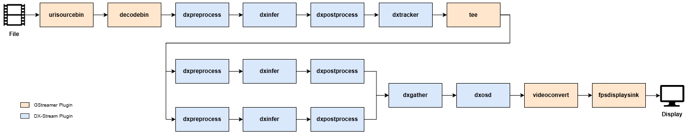

This section describes the secondary mode inference pipeline, which performs object-level inference based on objects detected in the primary mode. A single input stream is processed through primary inference for object detection, followed by tracking.  

The tracked objects are then passed to secondary inference, where additional tasks (object classification and face detection) run in two parallel branches split by `tee`. The results are stored in each object's metadata and merged by `dxgather`.  

Finally, the results are rendered for visualization.

The pipeline in the figure is defined in 
`dx_stream/pipelines/secondary_mode/run_secondary_mode.sh` and can be used as a reference for execution.

### **Explanation**  

**Pipeline Flow**  

- (1) **Object Detection**: Primary inference detects objects in the input stream  
- (2) **Tracker**: Assigns unique IDs to detected objects and tracks them across frames  
- (3) **Secondary Classification**: Classifies each tracked object with EfficientNet-Lite0 (runs in a `tee` branch, in parallel with (4))  
- (4) **Secondary Face Detection**: Performs face detection with SCRFD-500M only on objects of class ID 0 (`target-class-id=0`) that are at least 50×50 pixels, every 5th frame (`interval=5`)  
- (5) **Merge and Display**: `dxgather` merges the results of both branches, and `dxosd` draws them  

### **Usage Notes**  

**Configuration File Settings** 

- This pipeline runs multiple models: the primary model runs first, followed by two secondary models in parallel branches. Be careful to configure each model's preprocess_id and inference_id properly to avoid unexpected behavior.

**Secondary post process**

- When implementing a custom post-processing function for secondary inference mode, modify the provided DXObjectMeta directly. Removing or re-allocating the metadata may lead to unintended behavior.

---
